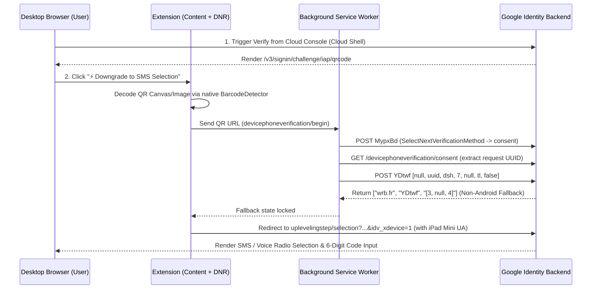

# Google QR SMS Helper (`google-qr-sms-helper`)

<p align="center">
  
  
  
  
</p>

<p align="center">
  <b>Switch Google's mandatory desktop cross-device QR verification (MO-SMS / GMS Constellation) back to standard 6-digit SMS / Voice code verification with a single click.</b>
</p>

<p align="center">
  <a href="./README.md">English</a> | <a href="./README_zh.md">简体中文</a>
</p>

---

## 📦 1. Installation Guide

### Method 1: Download Release Archive (Recommended for Beginners)
1. Go to the repository's **[Releases Page](https://github.com/verisimb/google-qr-sms-helper/releases/latest)**, download the latest `google-qr-sms-helper-v1.1.0.zip`, and extract it locally.
2. Open Chrome, Edge, or Brave, enter `chrome://extensions/` in the address bar, and press Enter.
3. Turn on the **"Developer mode"** toggle in the top-right corner.
4. Click **"Load unpacked"** in the top-left corner and select the extracted folder to install.

### Method 2: Install via Git Clone
```bash
git clone https://github.com/verisimb/google-qr-sms-helper.git
```
Then navigate to `chrome://extensions/`, enable **Developer mode**, click **Load unpacked**, and select the `google-qr-sms-helper` directory.

---

## 🚀 2. Step-by-Step Usage Guide

> [!IMPORTANT]
> **Core Prerequisite (Must Read)**: **Do NOT** attempt to downgrade directly from QR code pages launched by third-party clients (such as Antigravity / Gemini Code Assist authorization pages). Their `continue` parameters contain multi-level nested redirects that Google will intercept and push back to QR verification.  
> **You must first open Google Cloud Console and trigger the native `Verify` prompt via Cloud Shell**! Once you complete SMS verification here, your Google account permissions are unlocked globally, allowing smooth subsequent sign-ins for Antigravity and other tools.

### Step 1: Open Google Cloud Console & Trigger Cloud Shell Verification
1. Sign in to the Google account you wish to verify and go to **[https://console.cloud.google.com/](https://console.cloud.google.com/)**.
2. As shown below, click the **"Activate Cloud Shell" terminal icon `[>_]`** in the top-right navigation bar (or click **`1. Click Cloud Shell Icon`** in the extension's floating widget at the bottom right).
3. In the `Verify your account` dialog at the bottom, click the blue **`Verify`** button:


---

### Step 2: Click "Downgrade to SMS Selection" on the QR Code Page
1. Clicking `Verify` opens Google's QR verification page (`/v3/signin/challenge/iap/qrcode`).
2. Once the QR code image finishes rendering, click **「⚡ 一键降级到短信选择框 (Downgrade to SMS)」** on the extension's floating panel:
   - The extension automatically calls the browser's native `BarcodeDetector` API to scan and decode the QR code;
   - In the background, it sends `MypxBd` and `YDtwf ([null, uuid, dsh, 7, null, tl, false])` RPC requests to Google to obtain `[3, null, 4]` (non-Android device fallback state);
   - It automatically spoofs the current tab's request headers and environment as an **`iPad Mini`** (no manual DevTools / F12 emulation required) and redirects to `uplevelingstep/selection?...&idv_xdevice=1`.

---

### Step 3: Select "Text message (SMS)" & Enter Phone Number
1. The page redirects to the **verification method selection page (`/uplevelingstep/selection`)**:
   - Check **Text message (SMS)** (or Voice call), then click Next.
2. Enter your phone number (supports numbers from any country/region, virtual SMS platforms, or physical SIM cards) and click Send code.
3. Enter the 6-digit `G-xxxxxx` code received and click **Next** to complete account verification!
4. After verification succeeds, return to Cloud Shell or Antigravity / Gemini CLI and refresh to proceed.

---

## ❓ 3. FAQ & Troubleshooting

### Q1: Why does clicking downgrade jump back to the QR code when coming from other links?
- **Root Cause**: Only QR pages opened via **Cloud Shell `[>_]` -> `Verify`** on `https://console.cloud.google.com/` carry a clean `continue` parameter pointing directly to `https://accounts.google.com/uplevelingstep/selection?TL=...&authuser=0&flowName=GlifWebSignIn&sarp=1&scc=1`. Please make sure to follow **Step 1** via the Cloud Shell entry point.

### Q2: Why does the extension spoof an `iPad Mini` instead of an `iPad Pro` or desktop browser?
- **Root Cause**: Google's `uplevelingstep/selection` endpoint strictly validates the `User-Agent`:
  - Desktop environments (Windows / macOS) and DevTools' `iPad Pro 13` preset send a `Macintosh; Intel Mac OS X` desktop-class UA. When Google detects desktop environments, it ignores `idv_xdevice=1` and forces a redirect back to QR verification.
  - In contrast, `iPad Mini` sends a clean mobile UA header: `iPad; CPU OS 16_6 like Mac OS X ... Mobile/15E148`. In addition, submitting the 6-digit verification code on `/_/IdvUplevelingUi/data/batchexecute` requires an identical `iPad Mini` header throughout the session (fully handled automatically via `declarativeNetRequest` in v1.1.0 without manual DevTools intervention).

### Q3: What should I do if clicking "Downgrade" displays "Could not detect QR code on the current page"?
- Ensure you are using **Chrome / Edge 88+** (which supports the native `BarcodeDetector` API), and wait until the black QR code image on the page has fully loaded before clicking the button.

---

## ✨ 4. Technical Architecture & Workflow



---

## 📁 5. Project Structure

```text
google-qr-sms-helper/
├── assets/
│   └── cloud-shell-verify.png  # Cloud Shell Verify entry point screenshot
├── manifest.json               # Chrome Extension Manifest V3 configuration
├── background.js               # DNR full-path iPad Mini header spoofing + [3,null,4] RPC injection
├── content.js                  # Floating control panel + BarcodeDetector QR scanning + URL sanitization & redirect
├── ua_spoof.js                 # Main-world navigator property alignment
├── LICENSE                     # MIT Open Source License
├── README.md                   # Project documentation & visual guide (English)
└── README_zh.md                # Project documentation & visual guide (Simplified Chinese)
```

---

## 📄 License

Released under the [MIT License](./LICENSE).
